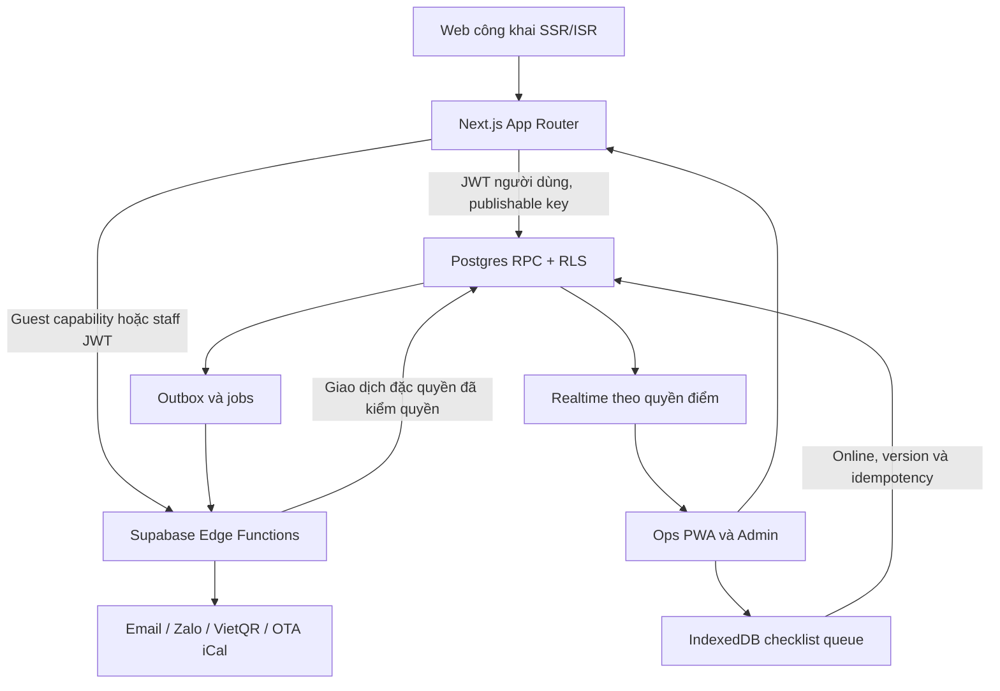

# Đặc tả kiến trúc codebase và dữ liệu

## 1. Phương án chọn

Một Next.js App Router trong monorepo pnpm/Turborepo, Supabase managed tại Singapore, public web + ops + admin dùng chung session/domain. So với tách ba app, phương án này ít pipeline/session duplication, phù hợp nhân sự GĐ0; module và route group tạo ranh giới để tách sau. So với CMS/booking SaaS rời, lõi chung giữ được orders/entity/CRM và SOP riêng. Đổi lại phải xây transaction/RLS và vận hành lịch đồng bộ cẩn thận.

Stack snapshot xem `../research/02-stack-research.md`. Chọn stable mới nhất có peer compatibility ở lúc scaffold, pin exact và lockfile; không dùng canary/RC. Không mặc định dùng Next.js 15 chỉ vì PRD ghi năm cũ. Node LTS được hosting hỗ trợ, baseline Node 24.x (đáp ứng các engine đã kiểm tra); xác minh patch lúc triển khai. Supabase Postgres dùng phiên bản managed thực tế, không tự áp PostgreSQL mới nhất ngoài khả năng platform.



## 2. Cấu trúc dự kiến (tất cả dưới prod)

```text
apps/web/
  src/app/
    (public)/                  # trang được index
    (auth)/                    # login, callback, reset, MFA
    (guest)/                   # receipt, booking/order access, no-store
    ops/                       # protected PWA
    admin/                     # protected admin
    api/                       # guest bridge, upload, cron callbacks
    robots.ts
    sitemap.ts
    manifest.ts
    llms.txt/route.ts
  src/features/{content,stay,commerce,ops,shop,crm,admin}/
    components/                # interactive islands
    queries.ts                 # server-only read model, RLS
    actions.ts                 # schema validate + auth + call RPC
  src/lib/{supabase,auth,seo,observability,pwa}/
  src/proxy.ts                 # refresh session, route guard
  public/{assets,ops-sw.js}/
  messages/vi.json
packages/
  core/src/{money,pricing,stay,commerce,shop,ops,contracts}/
  api/src/                     # typed RPC wrappers; injectable Supabase client
  db/src/database.types.ts     # sinh từ local schema
  db/fixtures/                 # dữ liệu giả, không PII thật
  ui/src/{tokens,components}/  # shadcn source + ZSOPO components
  config/                      # TS strict, ESLint flat shared config
supabase/
  config.toml
  migrations/                  # một nguồn migration duy nhất
  seed.sql
  tests/database/              # pgTAP
  functions/
    _shared/
    guest-commerce/
    payments/
    ical-sync/
    ical-export/
    notify/
    identity-docs/
    maintenance/
tests/{e2e,integration,performance}/
scripts/{check-rls.mjs,check-links.mjs,seed-validate.mjs}
.github/workflows/{ci.yml,deploy.yml}
pnpm-workspace.yaml
pnpm-lock.yaml
turbo.json
.env.example
```

PRD có migration ở cả packages/db và supabase: chốt chỉ `supabase/migrations`; `packages/db` giữ types/fixtures để tránh hai lịch sử schema. `apps/mobile`, warehouse, vector search, payout chưa tạo. `packages/api` ở GĐ0 chỉ wrappers thực sự dùng; không dựng abstraction cho mọi module tương lai.

## 3. Rendering, UI và truy cập

Server Components mặc định cho public page và read model; client chỉ form, calendar, cart, dialogs, realtime, queue. Không biến layout public thành `use client`; không đưa thư viện admin/charts vào bundle landing. `next/image` với sizes/allowlist; font Lexend/Be Vietnam Pro tự host qua next/font, mono chỉ cần mã. Tailwind 4 dùng CSS theme tokens từ JSON đã có; shadcn là source code trong packages/ui, không nhúng runtime prototype `support.js`/DCLogic.

Client Supabase tách browser/server/Proxy. Server dùng request cookies và publishable key + JWT người dùng. Proxy refresh và truyền cookie đúng theo [hướng dẫn SSR Supabase](https://supabase.com/docs/guides/auth/server-side/creating-a-client?framework=nextjs); xác minh bằng `getClaims`, dùng `getUser` khi cần trạng thái mới; không tin `getSession` để cấp quyền. Action/Route Handler/RPC đều tự authorize, không chỉ layout guard. Auth/private responses không cache chung, không ISR response có Set-Cookie.

Google OAuth và email/password ở S0, email là đường chính. Invite staff, reset password, signout, verify email, callback redirect allowlist. TOTP MFA bắt buộc với Admin/Finance/Super admin; action nhạy cảm kiểm `aal2`. Role DB là nguồn quyền hiện hành, JWT claims chỉ tăng tốc giao diện; thu hồi staff/role phải chặn ở DB ngay cả JWT chưa hết hạn.

RSC public chỉ đọc projection đã lọc published, không select `*` từ bảng private. Feature flag theo server: stay/shop/content bật theo release; learn/expert/events/member/give transactions tắt. Route chưa làm trả 404 có điều hướng hoặc trang giới thiệu thật, không form/nút giả.

## 4. Schema và invariant

Mặc định bảng nghiệp vụ có `id uuid`, `entity_id`, `created_at`, `updated_at`, `version int`; soft-delete cho danh mục, không soft-delete ledger/audit để che lịch sử. Bảng vận hành có `location_id`. Global identity và config có chủ sở hữu/phạm vi rõ, không giả một entity trên Auth user chung.

| Schema | Bảng GĐ0 và trường riêng |
|---|---|
| core | entities(code,kind,parent_entity_id), locations(entity_id,slug,status,timezone,sellable_config), profiles(auth user), user_roles(role,entity_id,location_id,disabled_at), customers(user_id nullable,display_name), customer_contacts(kind,normalized,verified_at), consent_records(purpose,version,accepted_at,revoked_at), media(bucket,path,entity_id,classification,expires_at), energy_cards(fields PRD), audit_logs(actor,action,redacted diff), outbox(dedupe_key,kind,aggregate_id,payload,status,attempts,next_run_at), guest_access_tokens(hash,scope,subject_id,expires_at,revoked_at), privacy_requests |
| commerce | orders(customer_id,kind,status,currency,total,deposit_due,paid_amount,policy_snapshot), order_items(entity_id,order_id,item_type,item_id,qty,unit_price,amount,revenue_source,snapshot), payments(provider,provider_ref,amount,state,received_at), payment_allocations(payment_id,order_id,amount), ledger_entries(event_id,account,amount,source,recognition_date,reversal_of), refund_requests(amount,reason,approved_by,evidence), idempotency_keys(scope,key,request_hash,result), cash_movements(shift_id,kind,amount,evidence) |
| stay | rooms(code,sellable,capacity,cleanliness,occupancy), rate_plans(priority,range,dow,price,extra_guest_fee,policy_version), bookings(order_id,room_id,stay,held_until,state,guest_counts), room_allocations(room_id,range,kind,source_id,active), calendar_feeds(room_id,provider,url_secret,token_hash,last_success), calendar_blocks(feed_id,external_uid,range,source_payload_hash), calendar_conflicts, services(group,unit,price,lead_time_min,prebook_discount_bp), service_requests(booking_id,service_id,order_item_id,scheduled_at,state), room_status_log, housekeeping_tasks(template_version,assigned_to,state,version), checklist_templates, checklist_results(task_id,item_code,result,note), inspections(BM03,signed_by), tickets(BM04,kind,priority,sla_due_at), ticket_events, shifts(BM01,cash_open,cash_counted,signed_by_next), linen_inventory, inventory_movements, supply_requests, lost_found_items, identity_documents(cipher_path,key_ref,expires_at) |
| shop | categories, products(slug,status,energy_card_id,ritual_content_id), product_variants(sku,price,attrs), warehouses, inventory(variant_id,warehouse_id,on_hand,reserved), stock_reservations(order_id,variant_id,qty,expires_at,state), stock_movements, carts, cart_items, shipments(order_id,address,carrier,tracking,state), shipping_rules(region,fee,free_threshold), back_in_stock_requests(contact_ref,consent), ritual_contents(slug,steps,media,status) |
| content | posts_cms(slug,title,excerpt,body_md,status,published_at,author_id,seo,cta), post_revisions(post_id,version,snapshot), categories, pages(slug,body_md,status), page_revisions, redirects(from,to), campaign_calendar(week,topic,channel,owner,status), contact_leads, newsletter_subscriptions |
| crm | tags, customer_tags, customer_notes, customer_merge_events, segments(filter_json), campaigns(channel,template,status), campaign_recipients(customer_id,consent_ref,status) |
| ops_config | notification_templates, delivery_logs, policy_versions, runtime_settings, incident_records, job_runs |

`order_items`, payments, allocations, stocks, media có composite FK bảo đảm con và cha cùng entity/location, không chỉ kiểm UUID tồn tại. `energy_cards` gắn phòng/location/product/service bằng FK thật tới card; `subject_type/subject_id` dùng trình bày và kiểm invariant, không để orphan polymorphic reference. Index entity/location/time, normalized contacts, slug/SKU, order code, `(feed_id, external_uid)`, unique `(provider, provider_ref)`, `(scope,key)`, `(dedupe_key)`.

Sổ cái chỉ append; sửa sai tạo reversal. Event unique bảo đảm không ghi hai lần. Tách cash/deposit liability/revenue/refund để dashboard không đếm cọc hai lần. Đây là operational subledger phục vụ xuất đối soát, không thay phần mềm kế toán/hóa đơn điện tử.

## 5. Khóa lịch và giao dịch tiền

Một bảng allocation chung mới là nơi enforce không trùng giữa booking và iCal/bảo trì. Ví dụ DDL định hướng (migration thực bổ sung FK/RLS):

```sql
create extension if not exists btree_gist;
create table stay.room_allocations (
  id uuid primary key default gen_random_uuid(),
  entity_id uuid not null,
  location_id uuid not null,
  room_id uuid not null,
  occupied_range tstzrange not null,
  kind text not null check (kind in ('hold','booking','ota','maintenance')),
  source_id uuid not null,
  active boolean not null default true,
  check (not isempty(occupied_range)),
  exclude using gist (room_id with =, occupied_range with &&) where (active)
);
```

Không đưa `now()` vào partial constraint. RPC khóa row room, hết hạn allocation cũ trong transaction, kiểm sellable/capacity/policy, tạo order/booking/allocation. Mọi writer kể cả import OTA/bảo trì/đổi phòng đều dùng cùng RPC/lock. DATE iCal quy về interval giờ nhận/trả của điểm, đảm bảo cùng-day turnover; snapshot raw dates để kiểm tra. Booking ở gần nhau dùng `[checkin, checkout)`; late checkout phải kiểm allocation kế tiếp.

OTA raw events có thể trùng nhau nên vẫn lưu raw `calendar_blocks`; projection vào allocation chỉ giữ interval busy đã hợp nhất hoặc báo conflict, không để constraint làm mất evidence. Import khóa theo phòng, reconcile busy union trong transaction; direct conflict được giữ trong conflict table và chặn bán thêm, có thông báo người xử lý. Test phân biệt lịch OTA mất event, duplicate, lỗi parse và conflict với direct.

Tiền dùng bigint VND trong DB; JSON transport là chuỗi decimal nguyên, không cast bigint tùy ý thành number. `packages/core` pure TS dùng bigint, basis points integer, kết quả serialize string. RPC đọc giá/version từ DB, không tin tổng tiền từ client. Pricing TS dùng preview/testing; DB transaction là authority, có parity tests trên fixture để tránh hai công thức lệch.

## 6. Contract liên phân hệ

Các chữ ký dưới đây là tên chuẩn cho plan. UUID/Instant/LocalDate là string được Zod validate; Money là decimal integer string; `DomainResult<T>` là `{ok:true,data:T}` hoặc `{ok:false,error:{code,message,field?,retryable}}`.

```ts
type Money = string;
type UUID = string;
type GuestInput = {name:string;phone:string;email?:string;notes?:string};
type StaySelection = {roomId:UUID;arrival:string;departure:string;
  adults:number;childrenAges:number[];
  services:{serviceId:UUID;qty:number;scheduledAt:string}[]};
type Quote = {id:UUID;version:number;total:Money;depositDue:Money;
  expiresAt:string;lines:{title:string;amount:Money}[];policyVersion:UUID};
type Hold = {bookingId:UUID;orderId:UUID;heldUntil:string;receiptPath:string};
type PaymentInput = {orderId:UUID;provider:string;providerRef:string;
  amount:Money;receivedAt:string;evidenceId?:UUID};
type PaymentResult = {paymentId:UUID;orderId:UUID;
  state:'allocated'|'needs_review';bookingState?:string};
type ChecklistOp = {operationId:UUID;taskId:UUID;baseVersion:number;
  itemCode:string;result:'pass'|'fail'|'na';note?:string;mediaIds:UUID[]};
type SyncResult = {operationId:UUID;state:'applied'|'duplicate'|'conflict'|'forbidden';version:number};
type ShopSelection = {lines:{variantId:UUID;qty:number}[];
  shippingAddress:{name:string;phone:string;line1:string;regionCode:string};
  method:'cod'|'bank';email?:string};
```

| Typed wrapper (packages/api) | RPC/Edge và quyền | Trả về |
|---|---|---|
| quoteStay(input:StaySelection) | guest-commerce -> quote_stay, public rate limit | DomainResult<Quote> |
| createStayHold(input:{quoteId:UUID;guest:GuestInput;policyVersion:UUID;idempotencyKey:UUID}) | guest-commerce -> create_stay_hold; server issue guest capability cookie | DomainResult<Hold> |
| recordPayment(input:PaymentInput & {idempotencyKey:UUID}) | payments Edge xác minh provider hoặc staff permission; record_payment_atomic | DomainResult<PaymentResult> |
| requestService(input:{bookingId:UUID;serviceId:UUID;qty:number;scheduledAt:string;idempotencyKey:UUID}) | guest stay capability hoặc staff -> request_stay_service | DomainResult<{requestId:UUID;orderItemId:UUID}> |
| transitionBooking(input:{bookingId:UUID;expectedVersion:number;action:'check_in'|'check_out'|'cancel'|'no_show';reason?:string;idempotencyKey:UUID}) | staff -> transition_booking | DomainResult<{state:string;version:number}> |
| applyChecklistOp(input:ChecklistOp) | staff -> apply_checklist_op | DomainResult<SyncResult> |
| approveInspection(input:{taskId:UUID;expectedVersion:number;approved:boolean;notes:string}) | inspector/manager -> approve_inspection, online | DomainResult<{roomState:string;version:number}> |
| createShopOrder(input:ShopSelection & {idempotencyKey:UUID}) | guest-commerce -> create_shop_order | DomainResult<{orderId:UUID;receiptPath:string;total:Money}> |
| getGuestReceipt() | scoped cookie -> guest-commerce projection | DomainResult<{orderId:UUID;state:string;paid:Money;due:Money}> |

Mã lỗi chuẩn: VALIDATION, UNAUTHENTICATED, FORBIDDEN, SOLD_OUT, QUOTE_EXPIRED, PRICE_CHANGED, HOLD_EXPIRED, PAYMENT_REVIEW, INVALID_TRANSITION, VERSION_CONFLICT, RATE_LIMITED, UPSTREAM_UNAVAILABLE. HTTP map 400/401/403/409/429/503; mọi UI có copy tiếng Việt và cách khôi phục. Logs có correlation ID không chứa nội dung giấy tờ/token.

## 7. RLS, guest và secrets

- RLS bật tất cả bảng nghiệp vụ, policies select/insert/update tách riêng; authenticated không có blanket write. `auth_has_role(role,entity,location)` đọc role active hiện hành, null scope chỉ cho role được định nghĩa global; grant function giới hạn, search_path cố định, schema-qualified.
- Function `SECURITY DEFINER` chỉ dùng khi cần transaction đặc quyền; revoke EXECUTE mặc định PUBLIC, allowlist caller, tự kiểm entity/location/ownership/input; không tin actor/entity client truyền. RLS view `security_invoker` nếu dựa RLS; public projection không lộ contact/giá vốn/keys.
- Service role/secret elevated chỉ Supabase Edge Function; không có trong Next.js/browser/preview bundle. Next.js bridge forward request tới Edge, Edge kiểm JWT hoặc guest capability. Public endpoints giới hạn payload, rate limit tập trung, kiểm Origin/CSRF khi dùng cookie và anti-bot. Không dùng in-memory rate limiter trên serverless.
- Guest token 256-bit random, DB lưu hash, scope/order cụ thể, hết hạn/thu hồi/rotation, đổi magic link một lần sang HttpOnly Secure SameSite cookie rồi redirect sạch URL. Token không trong analytics/referrer/log. Order code hay SĐT không đủ để xem đơn; email claim phải verify, phone chưa verify không tự gộp Auth.
- “Shadow account” PRD hiện thực bằng customer chưa có Auth login; khi người dùng nhận tài khoản đã xác minh mới link. Không tạo mật khẩu yếu hoặc account chỉ từ SĐT tự khai. Account cơ bản dùng cho giỏ/receipt, chưa mở hồ sơ năng lượng.
- Staff bị disable hoặc đổi entity phải mất quyền ở RPC/RLS ngay; Realtime channel re-auth và clear query cache. Housekeeping projection không có CCCD/full phone/payment.
- Audit append-only, actor server-derived, trước/sau đã redact; không sao chép PII vào audit làm vô hiệu TTL.

## 8. Media, CCCD và quyền riêng tư

Public media chỉ ảnh đã duyệt; private buckets cho housekeeping evidence, giấy tờ, payment evidence. Check mime thực, giới hạn dung lượng (đề xuất ảnh 10MB), strip EXIF, filename random; path entity/location/owner. Signed URL ngắn cho file không cần giải mã; kiểm entity trước cấp URL. CCCD không xuất public/signed plaintext blob.

PRD đề cập pgsodium nhưng [Supabase hiện không khuyến nghị extension này](https://supabase.com/docs/guides/database/extensions/pgsodium). Thiết kế đề xuất: mã hóa ứng dụng AES-256-GCM bằng Web Crypto trong Edge; ciphertext ở private bucket, key reference/version riêng, khóa bao trong secret store/KMS; Vault lưu secrets/tích hợp, không coi Vault tự động mã hóa toàn bộ media. Việc chọn key custody/KMS phải hoàn tất T11 trước dữ liệu thật, có round-trip/rotation test.

Xóa identity document và key riêng sau 30 ngày từ capture; job hằng ngày retry, log metadata xóa không có bản rõ; xóa file, thumbnail, reference và cache. Backup có retention riêng: giữ tombstone deletion, replay khi restore, không đưa dữ liệu hết TTL trở lại phục vụ; chọn crypto-erasure/key store độc lập nếu cần xóa không thể phục hồi trước hạn backup. Không tuyên bố xóa vật lý ngay khỏi mọi backup nếu chưa có bằng chứng.

Có consent version, marketing tách giao dịch, quyền export/correction/deletion qua privacy_requests; xử lý yêu cầu mục tiêu 72 giờ theo PRD, trường hợp phải giữ giao dịch có lý do và minimization, không xóa ledger tùy tiện. Đây là yêu cầu sản phẩm; pháp lý phải rà văn bản hiện hành trước mở bán, không coi viện dẫn NĐ13 trong PRD là kết luận pháp lý cập nhật.

## 9. Background, realtime và offline

Outbox transaction với nghiệp vụ; worker claim bằng `FOR UPDATE SKIP LOCKED`, lease timeout, dedupe key, attempts, exponential retry (1/5/15/60 phút, tối đa 5), dead-letter, admin resend có log. Provider idempotency key dùng khi hỗ trợ; delivery có thể at-least-once, không hứa exactly-once qua mạng. GĐ0 email + Zalo adapter cấu hình; gửi thật Zalo chỉ khi OA/template/token đủ. Job publish CMS, expire hold, reminders, purge docs, iCal, back-in-stock có idempotency và job_runs.

Realtime chỉ publish bảng/projection cần cho sơ đồ phòng, requests, tickets, task status; RLS/private channels đúng điểm. Reconnect fetch snapshot mới rồi áp delta/version, không chỉ tiếp tục nhận stream cũ.

Ops service worker scope `/ops/`, cache app shell/versioned static assets; chỉ allowlist offline read model tối thiểu. IndexedDB/Dexie queue tasks theo account, media blobs có TTL/dung lượng; queue bảo toàn qua restart. Ảnh offline chỉ ảnh checklist, không chụp giấy tờ offline. Quota đầy phải báo không lưu được, không hiển thị đã đồng bộ giả. Khi đổi assignment/role hoặc cùng item bị cập nhật thì conflict UI cho đọc bản server, giữ draft, quyết định gửi lại có quyền.

## 10. Môi trường và vận hành

Local Supabase Docker; preview dùng branch hoặc staging cô lập + dữ liệu giả; staging và production project riêng. Vercel runtime cùng vùng phù hợp Singapore, đo từ Việt Nam. Cấu hình `NEXT_PUBLIC_SUPABASE_URL`, `NEXT_PUBLIC_SUPABASE_PUBLISHABLE_KEY`, `NEXT_PUBLIC_SITE_URL`; khóa elevated/payment/email/KMS đặt ở Edge secrets, không `NEXT_PUBLIC_*`.

CI: lint, strict typecheck, core unit coverage ≥90%, Supabase reset+pgTAP, RLS table inventory, generated-types drift, Next build, Playwright, secret scanning. Script lint gọi ESLint CLI, không giả định `next lint` còn tồn tại. Preview có auth protection và noindex, không gửi mail thật; merge main -> staging; tag v* -> migration rồi promote production sau gate.

Migration expand/contract tương thích bản app trước. Rollback ưu tiên rollback app + forward corrective migration; không tự down migration phá dữ liệu đã thu tiền. Chỉ restore PITR khi incident commander quyết định, có reconciliation các giao dịch sau restore point.

PRD yêu cầu PITR 7 ngày, daily logical snapshot giữ 30 ngày và Storage backup tuần. [PITR là add-on, và DB backup không bao gồm file Storage](https://supabase.com/docs/guides/platform/backups); cấu hình/chi phí phải xác nhận, snapshot riêng nếu bật PITR. Restore drill gồm DB, buckets, secrets references, cron, quyền và deletion tombstones. RPO đề xuất ≤15 phút cho DB với PITR, Storage theo lịch backup; RTO mục tiêu 4 giờ được đo trong drill, không phải SLA nhà cung cấp cam kết.
